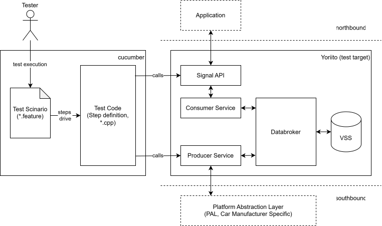

# Yoriito Vehicle API Integration Test

## Overview

This repository provides an integration testing environment for verifying the interaction between the **API** and **DataBroker (middleware)** in the Yoriito project.  
The purpose of these tests is to ensure that data is exchanged correctly between the components and that the expected behavior is achieved.  
The integration tests are implemented using **Cucumber**, a Behavior-Driven Development (BDD) tool.  
  
For more information about Cucumber, please refer to the following URL: https://cucumber.io/docs/

## Architecture



## Directory Structure
```bash
integration-test                                               # Integration test suite
├── README.md                                                  # Instructions and documentation for integration tests
├── TestArchitecture.drawio.svg                                # Architecture diagram of integration tests
├── CHANGELOG.md                                               # CHANGELOG
├── LICENSE                                                    # LICENSE
├── NOTICE.md                                                  # NOTICE
├── SECURITY.md                                                # Security Policy
├── cucmber.yml                                                # Configuration of Cucumber
├── Gemfile                                                    # Gemfile of cucumber-ruby
├── CMakeLists.txt                                             # CMakeLists.txt
└── cmake/                                                     # Cmake common files
└── features/                                                  # Cucumber feature files
     ├── support/
     │   └── env.rb
     ├── step_definitions/                                     # Step definitions for API–DataBroker integration scenarios
     │   ├── cucumber.wire                                     # Cucumber wire server configuration
     │   ├── step.h
     │   ├── step_get.cc                                       # Step definitions for the "Get" method
     │   ├── step_set.cc                                       # Step definitions for the "Set" method
     │   ├── step_inspect.cc                                   # Step definitions for the "Inspect" method
     │   ├── step_subscribe.cc                                 # Step definitions for the "Subscribe" method
     │   └── step_unsubscribe.cc                               # Step definitions for the "UnSubscribe" method
     └── domains/                                              # Domains for test
          ├── adas/
          ├── body/
          ├── cabin/
          ├── chassis/
          ├── currentlocation/
          ├── driver/
          ├── exterior/
          ├── lowvoltagebattery/
          ├── occupant/
          ├── powertrain/
          ├── trailer/
          ├── vehicle/
          ├── vehicleidentification/
          ├── versionyoriitovss/
          └── versionvss/
```
## Prerequisites
The following environment is required to run the integration tests:

- **OS**  
  - Windows (with WSL2: Ubuntu)  
  - Ubuntu 22.04 LTS  
  - Ubuntu 24.04 LTS

- **Headers/Libraries**
  - Kura
  - Yoriito API (headers and shared libraries)

- **Editor / Tools**  
  - Visual Studio Code (with **Dev Containers** extension)

## Installation
The steps to set up the environment for the integration tests are as follows:

1. Clone the repository from GitHub:
   ```bash
   git clone https://github.com/yoriito/integration-test.git
   ```
1. Open the project in Visual Studio Code and run it inside a Dev Container.

   - Start Visual Studio Code.
   - Open the directory you cloned in the previous step.
   - Open the Command Palette (**F1** or **Ctrl + Shift + P**).
   - Choose **Dev Containers: Reopen in Container**.
     This will build and launch the development environment inside a container.

## Usage
The steps to build and execute the integration tests are as follows:
1. Create a build directory and move into it:
   ```bash
   mkdir build
   cd build
   ```
1. Configure the project with CMake and enable the test modules:
   ```bash
   # Build ADAS domain
   cmake .. -D ENABLE_ADAS=ON
   # Build ADAS and BODY domains
   cmake .. -D ENABLE_ADAS=ON -D ENABLE_BODY=ON
   # Build all domains without any flags
   cmake .. 
   ```
1. Build the project using parallel jobs (this significantly reduces build time):
   ```bash
   make -j$(nproc)
   ```
   *Alternatively, specify the number of jobs explicitly (e.g., make -j4).*
1. Start the wire server in the background:
   ```bash
   # Start the wire server for ADAS, for example
   ./features/domains/adas/test_integration_adas &
   ```
1. Run Cucumber by specifying the feature file:
   ```bash
   cd ../
   cucumber ./features/domains/adas/set.feature_ADAS   # For the Set method
   ```

---

## Test Specification

### Placeholder List

| Placeholder | Description |
|-------------|-------------|
| `<path>` | VSS path |
| `<count>` | The number of attempts to update the target VSS signal |
| `<duplex>` | The multiplicity for updating the target VSS signal |
| `<datatype>` | Data type of the target VSS signal |
| `<value>`<sup>[1]</sup> | Test value used for validation of the target VSS signal |
| `<values>`<sup>[1]</sup> | Test values used for validation of the target VSS signal |
| `<default_value>`<sup>[1]</sup> | Default value of the target VSS signal |
| `<checked_value>`<sup>[1]</sup> | Test value used for validation of the target VSS signal |
| `<value_0>`<sup>[1]</sup> | Initial value for the target VSS signal |
| `<value_1>`<sup>[1]</sup> | Updated value for the target VSS signal |
| `<network_failure>` | Type of network failure |

---

[1]: The test values used for each placeholder are calculated according to the [Test Value Calculation Logic](#overall-approach).<br> 

## Test Specification for the Get Method

### Scenario: [HeadlessApp_Get_Sensor_Value](diagrams/get/1_headlessapp_get_sensor_value.drawio.svg) 

### Scenario: [HeadlessApp_Get_Sensor_Value_Unavailable](diagrams/get/2_headlessapp_get_sensor_value_unavailable.drawio.svg)

### Scenario: [HeadlessApp_Get_Sensor_Available_As_Actuator](diagrams/get/3_headlessapp_get_sensor_available_as_actuator.drawio.svg)

### Scenario: [HeadlessApp_Get_Sensor_With_ProducedTimestamp](diagrams/get/4_headlessapp_get_sensor_with_producedtimestamp.drawio.svg)

---

## Test Specification for the Set Method

### Scenario: [Cold start once and seed initial actuator values](diagrams/set/1_cold_start_once_and_seed_initial_actuator_values.drawio.svg)

### Scenario: [Overwrite/confirm after cold start (no restart)](diagrams/set/2_overwrite_confirm_after_cold_start_no_restart.drawio.svg)

The rules described in [handling-cases-where-a-default-value-exists](#handling-cases-where-a-default-value-exists) apply to this scenario.

### Scenario: [Millions of set requests do not kill kura server & values remain consistent](diagrams/set/3_millions_of_set_requests_do_not_kill_kura_server_values_remain_consistent.drawio.svg)

The rules described in [handling-cases-where-a-default-value-exists](#handling-cases-where-a-default-value-exists) apply to this scenario.

### Scenario: [Set requests are failed when the server is stopped](diagrams/set/4_set_requests_are_failed_when_the_server_is_stopped.drawio.svg)

### Scenario: [Set requests are failed when the network communication failure](diagrams/set/5_set_requests_are_failed_when_the_network_communication_failure.drawio.svg)

### Handling Cases Where a Default Value Exists

When a default value is defined in Yoriito VSS, the following rules are applied.

- **Scalar types**: The default value is used (taking precedence over the min and max constraints).
- **string[] types**: The default value is inserted at the beginning of `default_value` and at the end of `checked_value`.

---

## Test Specification for the Subscribe Method

### Scenario: [HeadlessApp_Subscribe_Sensor_Value](diagrams/subscribe/1_headlessapp_subscribe_sensor_value.drawio.svg)

### Scenario: [Notification of subscribed signals](diagrams/subscribe/2_notification_of_subscribed_signals.drawio.svg)

### Scenario: [Notification is delivered even if the signal is unavailable as sensor](diagrams/subscribe/3_notification_is_delivered_even_if_the_signal_is_unavailable_as_sensor.drawio.svg)

### Scenario: [Notification carries IsAvailableActuator as true when reported by the producer](diagrams/subscribe/4_notification_carries_isavailableactuator_as_true_when_reported_by_the_producer.drawio.svg)

### Scenario: [Notification carries a produced timestamp when the producer attaches one](diagrams/subscribe/5_notification_carries_a_produced_timestamp_when_the_producer_attaches_one.drawio.svg)

### Scenario: [Multiple subscriptions to a signal](diagrams/subscribe/6_multiple_subscriptions_to_a_signal.drawio.svg)

### Scenario: [Notification issued even if signal value being changed](diagrams/subscribe/7_notification_issued_even_if_signal_value_being_changed.drawio.svg)

### Scenario: [Millions of subscribe requests do not kill kura server & subscription_ids are correctly returned](diagrams/subscribe/8_millions_of_subscribe_requests_do_not_kill_kura_server_subscription_ids_are_correctly_returned.drawio.svg)

### Scenario: [Subscribe requests are failed when the server is stopped](diagrams/subscribe/9_subscribe_requests_are_failed_when_the_server_is_stopped.drawio.svg)

### Scenario: [Subscribe requests are failed when the network communication failure](diagrams/subscribe/10_subscribe_requests_are_failed_when_the_network_communication_failure.drawio.svg)

### Scenario: [Subscribe contexts are no longer available after the server is reset](diagrams/subscribe/11_subscribe_contexts_are_no_longer_available_after_the_server_is_reset.drawio.svg)

### Scenario: [All updates are notified to subscriptions without any drops even large burden on server or network](diagrams/subscribe/12_all_updates_are_notified_to_subscriptions_without_any_drops_even_large_burden_on_server_or_network.drawio.svg)

---

## Test Specification for the Unsubscribe Method

### Scenario: [The unsubscribe request for a signal that is currently subscribed has been successfully processed](diagrams/unsubscribe/1_the_unsubscribe_request_for_a_signal_that_is_currently_subscribed_has_been_successfully_processed.drawio.svg)

### Scenario: [Unsubscribe of one subscription_id does not hinder other subscription_ids](diagrams/unsubscribe/2_unsubscribe_of_one_subscription_id_does_not_hinder_other_subscription_ids.drawio.svg)

### Scenario: [Millions of unsubscribe requests do not kill kura server](diagrams/unsubscribe/3_millions_of_unsubscribe_requests_do_not_kill_kura_server.drawio.svg)

### Scenario: [Unsubscribe requests during network failure result in client error](diagrams/unsubscribe/4_unsubscribe_requests_during_network_failure_result_in_client_error.drawio.svg)

### Scenario: [Unsubscribe requests after recovery from network failure are succeeded](diagrams/unsubscribe/5_unsubscribe_requests_after_recovery_from_network_failure_are_succeeded.drawio.svg)

### Scenario: [Unsubscribe requests during server down result in client error](diagrams/unsubscribe/6_unsubscribe_requests_during_server_down_result_in_client_error.drawio.svg)

### Scenario: [Unsubscribe requests after server reset are succeeded](diagrams/unsubscribe/7_unsubscribe_requests_after_server_reset_are_succeeded.drawio.svg)

---

## Test Specification for the Inspect Method

### Scenario: [HeadlessApp_Inspect_Signal](diagrams/inspect/1_headlessapp_inspect_signal.drawio.svg)

---

## Test Value Calculation Logic

Test values (`default_value`, `checked_value`, etc.) are calculated according to the presence or absence of the **min**, **max**, and **allowed** constraints defined for the target VSS signal.

This section explains the classification rules and formulas used to derive these values.

### Overall Approach

1. Check whether the target VSS signal has min, max, or allowed constraints.
1. Classify the signal into one of the five patterns shown below.
1. Calculate `default_value` using the formula assigned to that pattern.
1. Different formulas are used for scalar types (e.g., `int32`) and array types (e.g., `int32[]`).
1. The `default_value` represents the initial value used by the test. The `checked_value` represents a valid test value used to verify API behavior and is generated according to the same min, max, and allowed constraints.

### Pattern Classification Table

| Pattern | Min Constraint | Max Constraint | Allowed Constraint | Scalar Formula | Array Formula |
|----------|----------|----------|----------|----------|----------|
| P1 | No | No | No | [Default Values](#default-values-for-each-data-type) | [Default Values](#default-values-for-each-data-type) |
| P2 | Yes | No | No | [Formula ①](#formula-1) | [Formula ① (Array Version)](#formula-1) |
| P3 | No | Yes | No | [Formula ②](#formula-2) | [Formula ② (Array Version)](#formula-2) |
| P4 | Yes | Yes | No | [Formula ③](#formula-3) | [Formula ④](#formula-4) |
| P5 | - | - | Yes | [Formula ⑤](#formula-5) | [Formula ⑥](#formula-6) |

### Default Values for Each Data Type

These are the baseline values used when there are no min or max constraints. When constraints are absent, the following "default max / middle / min values" are used for each data type.

| Data Type | default min value | default middle value | default max value |
|---|---|---|---|
| uint8 | 0 | 127 | 255 |
| uint16 | 0 | 32767 | 65535 |
| uint32 | 0 | 2147483647 | 4294967295 |
| int8 | -128 | 0 | 127 |
| int16 | -32768 | 0 | 32767 |
| int32 | -2147483648 | 0 | 2147483647 |
| float | -3.4028235E+38 | 0 | 3.4028235E+38 |
| double | -1.7976931348623157E+308 | 0 | 1.7976931348623157E+308 |

### Pattern 1: No min, max, or allowed Constraints

Since there are no constraints, use the [default values](#default-values-for-each-data-type) from the table above directly.

- **Scalar types**: `default value = default middle value`

### Pattern 2: Min Constraint Only
<a id="formula-1"></a>
**Formula ①**

```
■ If min > default max value OR default min value > min:
    Unreachable → This case should not occur
■ If default max value ≥ min ≥ default min value:
    default value = (default max value + min) / 2
```

### Pattern 3: Max Constraint Only
<a id="formula-2"></a>
**Formula ②**

```
■ If max > default max value OR default min value > max:
    Unreachable → This case should not occur
■ If default max value ≥ max ≥ default min value:
    default value = (default min value + max) / 2
```

### Pattern 4: Both Min and Max Constraints
<a id="formula-3"></a>
**Scalar types (Formula ③)**

```
default value = (max + min) / 2
```
<a id="formula-4"></a>
**Array types (Formula ④)**

```
default value = [min, (max + min) / 2, max]
```

### Pattern 5: Allowed Constraint
<a id="formula-5"></a>
**Scalar types (Formula ⑤)**

```
■ If allowed.length() ≥ 3:
    default value = allowed[1]
■ If allowed.length() = 2:
    default value = allowed[1]
■ If allowed.length() = 1:
    default value = allowed[0]
```
<a id="formula-6"></a>
**Array types (Formula ⑥)**

```
■ If allowed.length() ≥ 3:
    default value = [allowed[0], allowed[1], allowed[2]]

■ If allowed.length() = 2:
    default value = [allowed[0], allowed[1], allowed[0]]

■ If allowed.length() = 1:
    default value = [allowed[0], allowed[0], allowed[0]]
```

## Versioning

This project follows [Semantic Versioning](https://semver.org/).

The version is managed independently from the overall Yoriito version.

## Quality Assessment

This repository contains quality assessment results for this project.
Please refer to the [quality assessment page](./quality/quality-assessment.md).

The results are provided for transparency and reference purposes and do not constitute any warranty or guarantee of quality.

### Contents

- SW Integration Test

### Notes

Some files in this directory may be generated automatically by CI tools.

